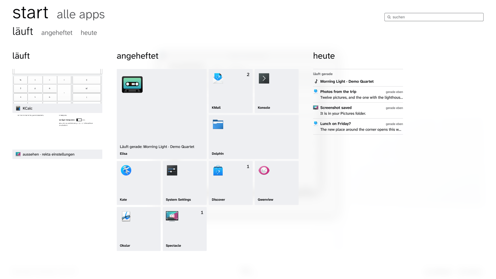
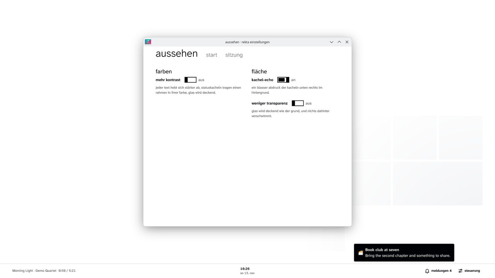
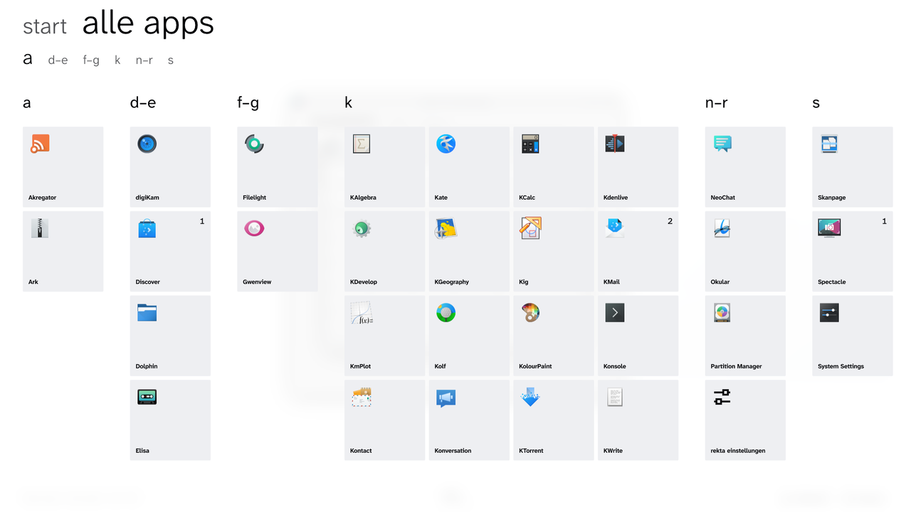
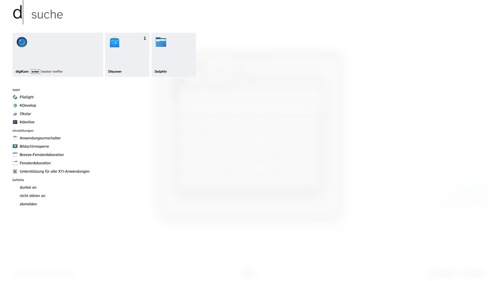
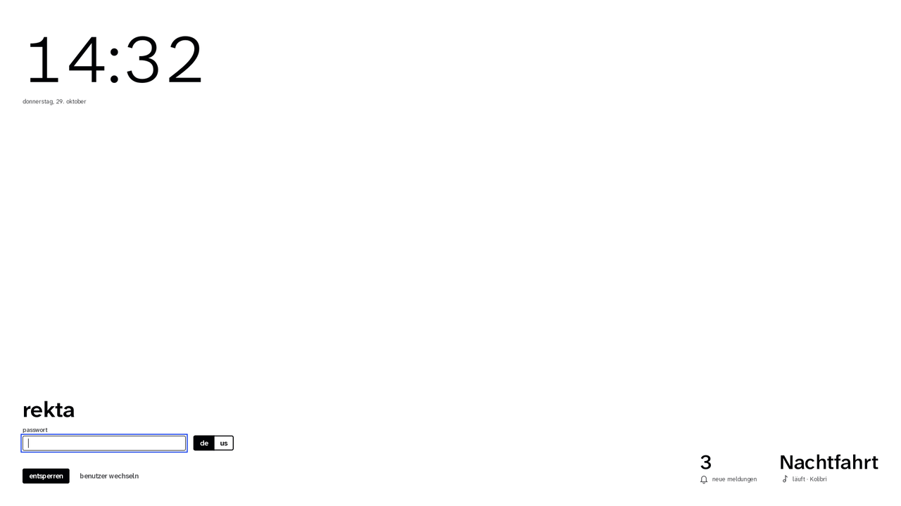
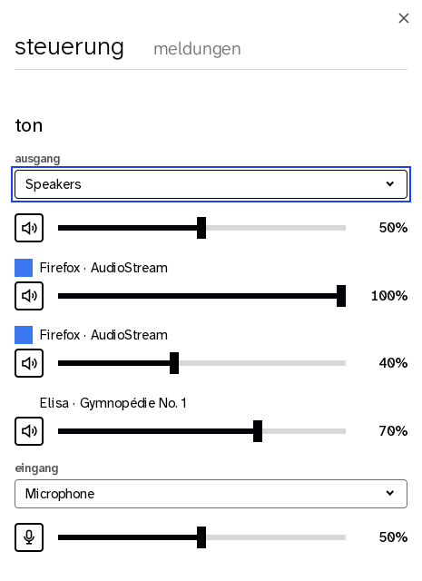
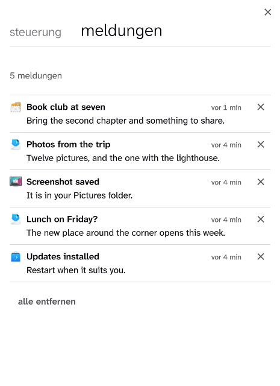

# rekta-shell

**A calm desktop for KDE Plasma 6, drawn strictly after [Rekta Design](https://rekta.design).**

rekta-shell takes the place of Plasma's panel and launcher with something quieter: a
Start that opens as a full-screen panorama of live tiles, a slim app bar, notifications
that rise from behind it and sink back, a side panel for sound and connections, and a
lock screen in the same language. Everything underneath stays KDE: KWin manages your
windows, Plasma's services keep running, and your apps and settings work as before.

It is for people who love what Plasma can do but want a desktop that steps out of the
way. Straight lines and plain words instead of chrome, large and very readable type,
colour only where something needs you, and motion that always shows where a thing
comes from and where it goes. The shell aims to be as fast and fluid as possible with
the smallest footprint it can manage: QML on [Quickshell](https://quickshell.org), a
few small KWin effects, no extra daemons.

rekta runs as a session of its own, next to Plasma. Pick it when you log in; Plasma
stays exactly as it was.

<picture>
  <source media="(prefers-color-scheme: dark)" srcset="docs/img/start-dark.webp">
  
</picture>

> **Beta.** rekta-shell is young and moves fast. It is good enough for a working day,
> but expect rough edges and read [Status](#status) before you switch.

## A look around

<table>
  <tr>
    <td width="50%">
      <picture>
        <source media="(prefers-color-scheme: dark)" srcset="docs/img/desktop-dark.webp">
        
      </picture>
      <br>The app bar, with a notification just risen from behind it.
    </td>
    <td width="50%">
      <picture>
        <source media="(prefers-color-scheme: dark)" srcset="docs/img/all-apps-dark.webp">
        
      </picture>
      <br>All apps, A to Z. Type a letter to jump.
    </td>
  </tr>
  <tr>
    <td width="50%">
      <picture>
        <source media="(prefers-color-scheme: dark)" srcset="docs/img/search-dark.webp">
        
      </picture>
      <br>Start typing to search apps, windows, settings and commands.
    </td>
    <td width="50%">
      <picture>
        <source media="(prefers-color-scheme: dark)" srcset="docs/img/lock-dark.webp">
        
      </picture>
      <br>The lock screen.
    </td>
  </tr>
  <tr>
    <td width="50%">
      <picture>
        <source media="(prefers-color-scheme: dark)" srcset="docs/img/panel-dark.webp">
        
      </picture>
      <br>The side panel: sound, with a row for each app that plays.
    </td>
    <td width="50%">
      <picture>
        <source media="(prefers-color-scheme: dark)" srcset="docs/img/notifications-dark.webp">
        
      </picture>
      <br>The notification centre.
    </td>
  </tr>
</table>

Light or dark follows your system; these pictures follow your browser.

## What it does

The shell speaks German for now, in Rekta's lower case; the words in quotes below are
what you see on screen.

### The Start

- **Opens on Meta**, or with a swipe up from the bottom edge of a touch screen, or three
  fingers up on a touchpad. Your windows step back, and the Start folds in from the
  title down; it follows your finger when you swipe.
- **One panorama, scrolled sideways:** running windows, pinned apps, "heute" (what is
  playing and the newest notifications) and "zuletzt" (files you opened lately). A strip
  at the top shows where you are and takes you there.
- **Live tiles.** Pinned apps come in four sizes and show what is new: the count of
  unseen notifications, and on a wide tile the track a player is playing. News peeks in,
  the way Rekta's tiles tell it.
- **Pin, size and unpin** from a tile's menu (right click, long press or the Menu key), or
  in the settings app; every change can be undone.
- **"alle apps":** every app as a tile, A to Z, in sections by letter. Type a letter to
  jump there.
- **Search by typing.** Apps whose name matches become tiles, the best one wide; more
  matches, open windows, system settings pages and the shell's own commands follow as
  rows. A calculation shows its result; when nothing matches, the search offers to ask
  the web.

### The app bar

- A slim bar along the bottom edge with the clock and the date; a press shows the month,
  with week numbers.
- **Status words appear only when something differs** from the usual: muted, do not
  disturb, a microphone in use, a screen being shared. The last two stand in the error
  colour, because they concern your privacy.
- The bar's leading end shows what is playing. Volume, microphone, brightness and keyboard-layout
  keys turn the clock into a level for a moment.
- **"im hintergrund"** holds the apps that live in the tray, with their menus.

### Notifications

- A notification rises from behind the bar, waits, and goes back behind it into the
  count. Act on it, dismiss it, or reach it with Meta+Shift+N.
- The centre ("meldungen", Meta+N) lists them by time. Swipe one away or press its ×;
  "rückgängig" (undo) brings it back.
- **Do not disturb** for as long as you want, for an hour or until tomorrow; the bar
  counts down.
- Banners for states that need you, such as a disk running full.

### The side panel

- "steuerung" opens with Meta+A, a swipe in from the right edge, or three fingers left on
  a touchpad.
- Sound output and input with volume and mute, and a row for each app that plays.
- Wi-Fi networks and Bluetooth devices in place, with a sheet for a network's password.
- What is playing, with its controls; quick switches for dark mode, do not disturb, Wi-Fi
  and Bluetooth; density and the power profile.

### Lock screen and session

- Rekta's own lock screen, shown by Plasma's screen locker in the rekta session only: a
  large clock, the count of new notifications, what is playing, and "benutzer wechseln"
  (switch user) beside unlock.
- Ctrl+Alt+Delete opens the session bar: lock, switch user, log out, restart, shut down.
  Logging out, restarting and shutting down wait five seconds, so you can still change
  your mind.

### Motion with meaning

- Every movement follows Rekta's motion rules: places turn in and out like pages, the
  Start folds in row by row, new rows arrive and old ones leave, tiles peek when their
  news changes, and virtual desktops turn like a turnstile.
- Small KWin effects carry the motion that belongs to the windows: they step back behind
  the Start, turn with the desktops, and a held Meta key is noticed.
- Set KDE's animation speed to instant, and everything is immediate; other speeds do not change the shell's motion.

### Keyboard, touch and touchpad

- Everything works from the keyboard. Hold Meta, or press `?`, to see the key map.
- Touch: swipe up from the bottom edge for the Start and draw it down to close it; swipe
  in from the right edge for the side panel; long-press for a tile's menu.
- Touchpad: three fingers up and down for the Start, left and right for the side panel.
- Controls carry names for screen readers, and a key that changes a level announces the
  new value.

### Make it yours

- "rekta einstellungen", the settings app: the theme (light, dark or black; light and dark
  switch Plasma's colour scheme like the panel's "dunkel"), more contrast, less transparency,
  the tile echo on the background, what Escape does in the search, the pinned apps and
  whether "zuletzt" shows.
- More contrast makes every text pair 7:1 and the glass opaque; less transparency turns
  the glass solid and blurs nothing behind it.
- Your system's configuration sets the defaults; each user's own settings file wins over
  them, and the shell follows changes while it runs.

### Actions over D-Bus

The shell lists what it can do on the session bus as `rekta.Actions1`: its own commands
(dark mode, do not disturb, the key map, mute, volume, the session actions) and the
desktop actions of installed apps, such as a browser's "new private window". `ListActions`
returns them with names and icons, `Invoke` runs one. Logging out, restarting, shutting
down and switching user only open the session bar, focused on that action; they never
act on their own.

```sh
busctl --user call rekta.Actions /rekta/Actions rekta.Actions1 ListActions
```

## Try it

**For a first look, without installing anything** (Nix with flakes, inside a Wayland
desktop): run the shell in a KWin of its own, in a window on your desktop. It builds the
shell first, then starts with its own home directory and session bus and leaves your
desktop alone.

```sh
nix run github:DerDaehne/rekta-shell#nested -- --window
```

It is a look, not a session: none of your apps are there, the Start stands open while no
window is, and Meta stays with your own desktop. The app bar and the side panel answer
the pointer; the side panel shows your machine's real network and Bluetooth state but
changes nothing.

**On NixOS** with Plasma 6: add the flake, import `nixosModules.default` and set
`programs.rekta-shell.enable = true;`. Your display manager then offers "rekta" beside
"Plasma". See [Installation on NixOS](#installation-on-nixos).

**On Fedora** with Plasma 6.8: install the RPM with Quickshell from its COPR. See
[Installation on Fedora](#installation-on-fedora).

## Status

rekta-shell is a beta: it is meant to carry a working day on Plasma 6.8, but it is
young. What to expect:

- **German only.** The shell's words are German, in Rekta's lower case; there are no
  translations yet.
- **Plasma 6.8 and Quickshell 0.3.** The KWin effects are built for one exact KWin
  release; the Fedora package pins it.
- **Not there yet:** a clipboard history, desktop widgets, icons on the desktop, and a Rekta login screen; your display manager's
  greeter stays as it is.
- **Density** is compact unless you choose otherwise: the shell does not detect touch
  screens yet, so pick "bequem" (comfortable) in the side panel on a touch device.
- Things will change between versions, including settings.

Problems and ideas are welcome as
[issues](https://github.com/DerDaehne/rekta-shell/issues).

## Rekta Design

rekta-shell is one implementation of [Rekta Design](https://rekta.design), a platform-neutral
design language for apps, desktop-first, on the web and native: tiles, panoramas, words before icons,
straight edges and motion with meaning. Its specification and tokens live at
[github.com/DerDaehne/rekta-design](https://github.com/DerDaehne/rekta-design). The
shell takes every colour, size, duration and curve from Rekta's tokens at a pinned
release, and it differs on purpose in only a few places, such as its typeface,
[Atkinson Hyperlegible Next](https://www.brailleinstitute.org/freefont/).

## Installation on NixOS

On NixOS with Plasma 6, import the NixOS module and enable it. The display
manager then offers the session "rekta" beside "Plasma"; Plasma itself stays
as it is.

```nix
{
  inputs = {
    nixpkgs.url = "github:NixOS/nixpkgs/nixos-unstable";
    rekta-shell = {
      url = "github:DerDaehne/rekta-shell";
      inputs.nixpkgs.follows = "nixpkgs";
    };
  };

  outputs =
    { nixpkgs, rekta-shell, ... }:
    {
      nixosConfigurations.example = nixpkgs.lib.nixosSystem {
        modules = [
          ./configuration.nix
          rekta-shell.nixosModules.default
          {
            services.desktopManager.plasma6.enable = true;
            programs.rekta-shell.enable = true;
          }
        ];
      };
    };
}
```

The module builds the shell with your system's nixpkgs, so Quickshell shares
Qt with your Plasma. `homeManagerModules.default` offers the same
options per user and puts the `rekta-shell` and `rekta-settings` commands into the
user's profile. The session itself runs the NixOS module's package, so it takes the
NixOS module's options; the home-manager options only set the defaults of the commands
in the profile, such as `rekta-settings`, so set the same values there if you want the
settings app to show the same defaults. Importing the modules
changes nothing until a configuration sets `programs.rekta-shell.enable`, which is
off by default. Once enabled, `installFont` (default on) also installs the typeface
Atkinson Hyperlegible Next; set it to `false` when your configuration provides the
typeface itself.

Without the modules, the flake provides `packages.<system>.rekta-shell` and
`overlays.default`. The package carries the session as well: register it with
`services.displayManager.sessionPackages` and `systemd.packages`. Use the
overlay, or set `inputs.rekta-shell.inputs.nixpkgs.follows = "nixpkgs"`, so the
shell is built against your own nixpkgs; `packages.<system>` alone uses this
flake's own nixpkgs pin.

Both modules offer the same options, all under `programs.rekta-shell`:

| Option | Values | Default |
| --- | --- | --- |
| `background` | `"rekta"` (Rekta's tile echo in a corner) or `"solid"` (the plain ground colour) | `"solid"` |
| `contrast` | `"more"` (every text pair 7:1, opaque glass, framed status tiles) or `"normal"` | follow the system |
| `transparency` | `"reduce"` (glass turns solid, nothing behind it blurs) or `"normal"` | `"normal"` |
| `ground` | `"black"` (the dark theme on black for OLED screens, glass is the ground and the app bar does not blur; the lock screen stays dark) or `"normal"` | `"normal"` |
| `density` | `"comfortable"` or `"compact"` | compact |
| `searchEscape` | `"close"` (clear the search and close the Start) or `"back"` (clear it and go back) | `"close"` |
| `showRecent` | `false` hides "zuletzt" and reads nothing of what was opened | shown |
| `installFont` | `false` when your configuration provides Atkinson Hyperlegible Next itself | `true` |

The module's options are the shell's defaults. Each user can set their own in
`~/.config/rekta-shell/settings.json`, which wins over them and takes effect
while the shell runs, for example `{ "version": 1, "background": "rekta" }`.
The settings app ("rekta einstellungen") writes that file; nothing in the Nix
configuration does.

## Using rekta as a second session on NixOS

- **Switch sessions:** log out and pick "rekta" in the display manager's
  session list; to go back, log out and pick "Plasma". The display manager
  preselects the last session, so after a failed rekta login pick Plasma
  explicitly.
- **Update:** run `nix flake update rekta-shell` in your configuration, then
  build and switch as usual. The new shell starts with the next rekta login;
  inside a running rekta session, `systemctl --user restart rekta-shell` picks
  it up at once. KWin keeps the rekta effects it loaded until the next login;
  meanwhile the shell offers only what the running effects can do (the Start's
  "fenster" says "nach neuer anmeldung"), says so once per start in a toast
  whose "abmelden" opens the session bar, and names the older effect in its
  journal (`FadeBackEffect:`).
- **Go back to an earlier version:** revert the `flake.lock` change and switch
  again, or `nixos-rebuild switch --rollback`, or boot an earlier generation.
- **What both sessions share:** KDE's settings (`kwinrc`, `kdeglobals`,
  shortcuts) and the session restore, so windows open at logout reopen in the
  other session. The rekta session adds its own KWin defaults (its desktop
  switch, blur strength, no open animation) through a drop-in that only acts
  in rekta; your own `kwinrc` settings win over them.
- **When the shell misbehaves:** `systemctl --user status rekta-shell` and
  `journalctl --user -u rekta-shell -b`; KWin logs with
  `journalctl --user -u plasma-kwin_wayland -b`. The shell restarts after
  every exit, at most three times a minute; after that the unit stays failed
  and the session runs on without it. Bring it back with
  `systemctl --user reset-failed rekta-shell && systemctl --user start rekta-shell`.
- **When the session does not come up at all:** switch to a text console
  (Ctrl+Alt+F3), log in, end the session with `loginctl terminate-session <id>`
  (see `loginctl list-sessions`) and pick Plasma in the display manager. Last
  resort: set `programs.rekta-shell.enable = false;` and switch, or roll back.

## Installation on Fedora

Fedora is supported as an x86_64 RPM. Requirements: a Fedora release that ships
Plasma 6.8 or newer, and Quickshell 0.3, which Fedora does not package yet.

1. Enable the Quickshell repository first. It is a third-party COPR and not part
   of this project:

   ```sh
   sudo dnf copr enable errornointernet/quickshell
   ```

2. Plasma 6.8 is in Fedora 45's `updates-testing` repository for now. Until it
   is stable, enable that repository once to bring Plasma up to 6.8 (this step
   goes away when Fedora ships Plasma 6.8 as a stable update):

   ```sh
   sudo dnf --enablerepo=updates-testing upgrade
   ```

3. Download the RPM for your Fedora release and `SHA256SUMS` from the
   [GitHub release](https://github.com/DerDaehne/rekta-shell/releases) of the
   version you want (the file name carries the release, for example `fc45`),
   then check it and install it:

   ```sh
   sha256sum -c --ignore-missing SHA256SUMS
   sudo dnf install ./rekta-shell-*.fc45.x86_64.rpm
   ```

   The RPM is not signed, so `dnf` does not verify it; the checksum is the check.

   Until the first release is tagged, and to try the state of `main` between
   releases, download the workflow artifact of a build of `main` instead (it
   expires after 30 days). This needs the GitHub CLI, signed in once with
   `gh auth login`; it works from any directory:

   ```sh
   gh run list -R DerDaehne/rekta-shell -w rpm -b main -L 1 --json databaseId -q '.[0].databaseId'   # the run id
   gh run view <run-id> -R DerDaehne/rekta-shell              # lists the artifact: rekta-shell-<version>-fc45-<sha7>
   gh run download <run-id> -R DerDaehne/rekta-shell -n rekta-shell-<version>-fc45-<sha7>
   sudo dnf install ./rekta-shell-*.fc45.x86_64.rpm
   ```

   The artifact holds the RPM and the source RPM but no `SHA256SUMS`; it comes from the
   project's own build of that commit.

4. Log out and pick "rekta" in the login manager's session list: the gear icon
   in GDM, the session selector in the Plasma Login Manager or SDDM. To go back,
   log out and pick "Plasma". The login manager preselects the last session, so
   after a failed rekta login pick Plasma explicitly.

The package depends on the exact KWin version it was built against (for
example `kwin-libs = 6.8.2`): KWin loads the shell's two KWin effects only when
they were built for its own version, down to the patch release. When Fedora
publishes a newer KWin, `dnf upgrade` keeps KWin at the installed version
until a rekta-shell RPM built against the new KWin is installed.

### Defaults, update, removal

- **Defaults:** `/etc/rekta-shell/defaults.json` holds the system-wide defaults.
  It is a JSON object with the keys `background` (`"solid"` or `"rekta"`) and
  `density`, and ships as `{ "background": "solid" }`. A user's own
  `~/.config/rekta-shell/settings.json` wins over it. The shell reads the
  defaults at start, so a change takes effect after
  `systemctl --user restart rekta-shell` or the next login. A changed file is
  kept on updates (the new one arrives as `defaults.json.rpmnew`) and on
  removal (as `defaults.json.rpmsave`).
- **Update:** install the newer RPM the same way as above. `dnf upgrade` does
  not find a new rekta-shell by itself, since a release RPM brings no
  repository. The new shell starts with the next rekta login; inside a running
  rekta session, `systemctl --user restart rekta-shell` picks it up at once.
- **Remove:** `sudo dnf remove rekta-shell`. `dnf` also offers to remove
  packages that only rekta-shell pulled in, which on a system without Plasma
  includes Plasma itself; read the list before confirming. Your home directory
  is not touched.
- **Troubleshooting and the way back:** `systemctl --user status rekta-shell`
  and `journalctl --user -u rekta-shell -b` show what the shell does; the
  notes in "Using rekta as a second session on NixOS" about restarts apply
  unchanged. If the session does not come up at all, switch to a text console
  (Ctrl+Alt+F3), log in, end the session with `loginctl terminate-session <id>`
  (see `loginctl list-sessions`) and pick Plasma. Last resort:
  `sudo dnf remove rekta-shell`.

### Next to GNOME

rekta also runs on a Fedora Workstation with GNOME, next to it. The RPM then
pulls in the Plasma services the session needs (about 750 MiB on disk), and
`plasma-nm` and `bluedevil` as weak dependencies; they answer network passwords
and Bluetooth pairing in the rekta session, and `--setopt=install_weak_deps=False`
leaves them out. GNOME itself stays unchanged. What you notice when you switch:

- **Two password stores:** the rekta session uses KWallet, GNOME uses
  gnome-keyring. Passwords saved in one are not visible in the other.
- **Portals:** GNOME uses the GNOME portals, rekta the KDE ones, so file dialogs
  look different in each session.
- **Application lists:** rekta lists GNOME's apps as well. KDE apps that are
  marked KDE-only do not show up in GNOME. The Plasma welcome centre starts the
  first time you log in to rekta.
- **Network and Bluetooth:** NetworkManager and BlueZ are the same services in
  both sessions; only the agent that asks for passwords and pairing differs.
- **`xwaylandvideobridge` starts in GNOME:** a weak dependency of Plasma that
  autostarts in every desktop. It is invisible, and rekta does not need it:
  `sudo dnf remove xwaylandvideobridge`.
- **Leftovers:** the first session you start writes configuration (`kdeglobals`,
  `kwinrc` and more in `~/.config`) that the other session ignores.

## Background images

rekta ships its background images as a separate data package in KDE's wallpaper format
(`share/wallpapers/rekta-<name>/`), so Plasma's picker finds them too: the flake package
`rekta-backgrounds` and the RPM `rekta-shell-backgrounds` (noarch). The first one is "sky", a
softly blurred evening sky (1920x1080, lossless WebP, 0.9 MB). The images were generated with
Claude and are CC0 ([backgrounds/LICENSE](backgrounds/LICENSE)). The shell does not show them
yet. WebP needs Qt's `qtimageformats`: Plasma's NixOS module installs it, and the RPM requires it.

## A link for "problem melden"

The session bar (Ctrl+Alt+Delete) can offer "problem melden", which opens a web
page of your choice, such as your issue board, in the browser. It shows only
while `~/.config/rekta-shell/report.json` holds an `http` or `https` link:

```json
{ "url": "https://…" }
```

The shell follows the file while it runs; delete it and the action goes. Keep
the link in this file rather than in your Nix configuration, which would copy
it into the world-readable Nix store. The shell itself sends nothing: no logs,
no credentials.

## Building and developing

rekta-shell is a Nix flake around one CMake project: the QML shell and its library
`Rekta` (in `shell/`), a small D-Bus module in C++ (`plugins/dbus/`), the KWin effects
(`kwin/`), the lock screen package (`lockscreen/`) and the session files (`session/`).
Rekta Design is a flake input pinned to one release; `shell/Rekta/Tokens.qml` and the
icons are generated from it.

```sh
nix flake check          # build, lint (warnings fail), token drift, QML tests, modules, formatting
nix develop              # qs, qmllint, qmlformat, node, gitleaks, nixfmt, rekta-qmllint
nix build                # result/bin/rekta-shell
nix run .#nested         # the shell in a KWin of its own (headless; --window to watch), reloads on every change
nix run .#nested-shot -- shot.png   # a screenshot of that nested desktop
nix run .#vm             # a throwaway NixOS VM with Plasma 6 and the rekta session
nix run .#tokens         # regenerate the tokens and icons from the pinned Rekta Design
nix build .#contact-sheets -L       # the QML tests once more, keeping their pictures
```

The nested session starts from an empty environment with its own home, runtime
directory and session bus, so nothing in it reaches your desktop's settings or
services. Run the shell there, or in the VM, rather than in your own session.

## Contributing

This repository is public, so nothing private may enter it. Before every commit
run `scripts/scan-secrets.sh`: gitleaks over the history and the pending
changes, built-in checks (board references, English comments, no local home
paths, noreply commit identities) and a scan against your own private patterns.

Put those patterns into `.privacy-patterns` in the repository root — one
`grep -E` regex per line, for example your real name, private mail addresses,
host and device names. The file is gitignored; `.privacy-patterns.example`
shows the format. A hit names only the file, line or commit and a pattern
number, never the pattern itself. `scripts/scan-secrets.test.sh` tests the
scan.

## Licence

Code is MIT ([LICENSE](LICENSE)), documentation CC BY 4.0
([LICENSE-docs](LICENSE-docs)). Third-party material: [NOTICE](NOTICE).
The background images are CC0 ([backgrounds/LICENSE](backgrounds/LICENSE)).
